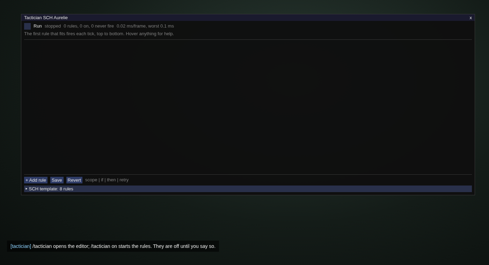
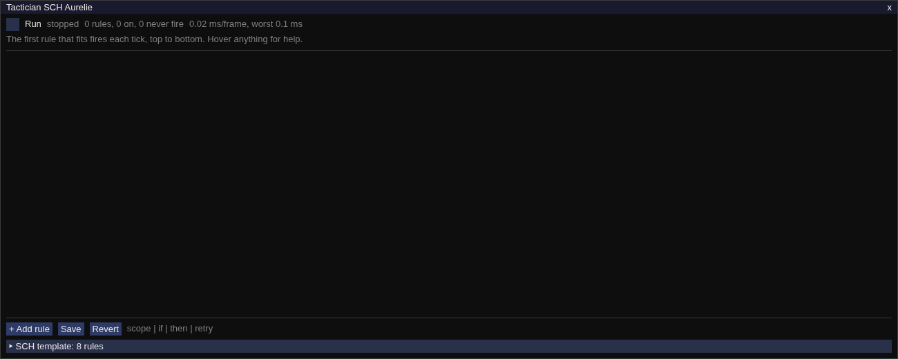
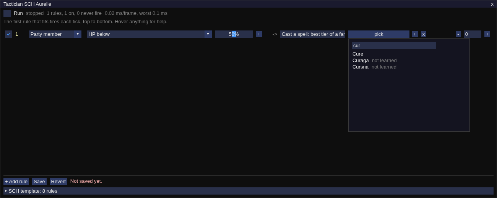
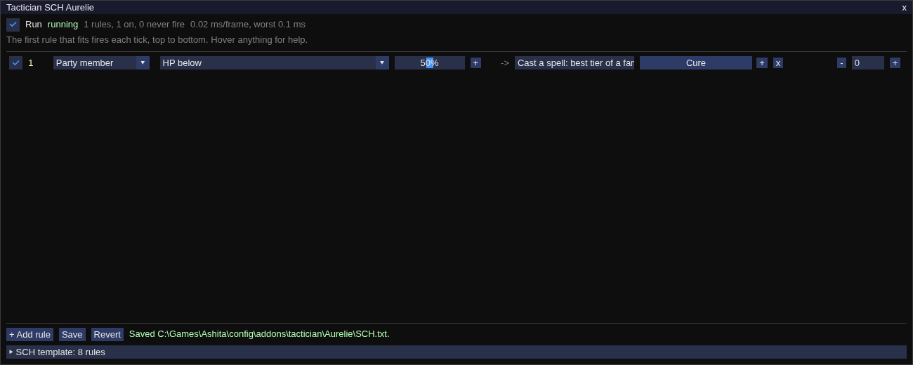
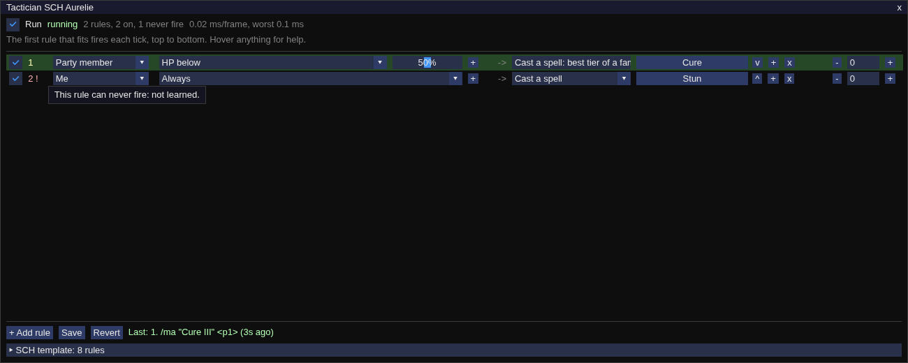
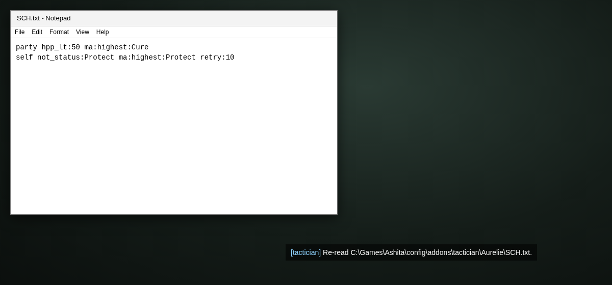

# From a fresh install to a running rule

Six steps, one screenshot each, shot at the default UI scale and cropped to the editor window. Each caption says what to do and what to expect, and names the version it was shot with; the shots are retaken when the editor layout changes. For what to check when nothing fires, see [Nothing happens](../README.md#nothing-happens) in the README.

## 1. Install and open the editor

Unzip `tactician-vX.Y.Z-ashita.zip` into `Ashita/addons/`, then in the game:

```
/addon load tactician
/tactician
```



The load prints one line: `/tactician` opens the editor, `/tactician on` starts the rules, and they are off until you say so. `/tactician` opens the window. (tactician vX.Y.Z)

## 2. The empty editor



A job with no rule file shows no rows and `0 rules, 0 on, 0 never fire`. For a job that ships a template, the footer carries a `SCH template: 8 rules` header; open it and `Add all` or `Start over with these` puts the set in the editor. Without a template, start from `+ Add rule`. (tactician vX.Y.Z)

## 3. Add a rule

Click `+ Add rule`. A row appears reading `Me / Always / Cast a spell / pick`. Set it left to right: the scope (`Party member`), the condition (`HP below`) and its value (drag the slider to 50, or ctrl-click it to type), the kind of action (`Cast a spell: best tier of a family`), then `pick` to open the list.



The picker lists what the job can use; type into the search box and click the name. A greyed entry says beside it why it cannot be picked yet. The row now reads `Party member / HP below 50% / Cast best Cure`. (tactician vX.Y.Z)

## 4. Save and start the rules

Click `Save`, then type `/tactician on` or tick `Run` in the header.



`Save` writes `config/addons/tactician/<character>/<JOB>.txt` and the footer names the path. Until then the footer says `Not saved yet.` and nothing runs. `Run` turns the state beside it from off to running; the rules are off again at the next load. (tactician vX.Y.Z)

## 5. A rule that fired, and one that never can



The row that fired last is shaded green and the footer says what was sent and how long ago. A row whose number is marked `!` can never fire as written; hover the number for the reason, such as `not learned` for a spell the character does not have. (tactician vX.Y.Z)

## 6. Edit the file by hand

Open `config/addons/tactician/<character>/<JOB>.txt` in a text editor. One rule per line, in the form the README's Rules section gives:

```
party hpp_lt:50 ma:highest:Cure
self not_status:Protect ma:highest:Protect retry:10
```

Save the file, then `/tactician reload`.



`/tactician reload` re-reads the file and the editor shows the new rows. A line that does not parse is kept and shown in red with the error; fix it in the file or delete it in the editor. (tactician vX.Y.Z)
